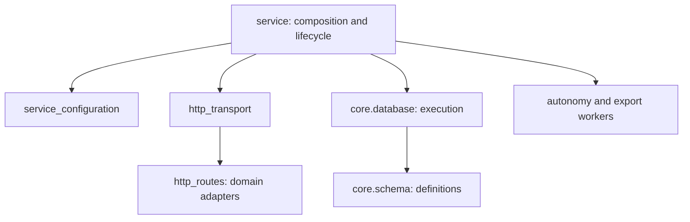

# 架构边界与维护规则

## 当前职责

| 模块 | 责任 | 主要约束 |
| --- | --- | --- |
| noyra.service | 对外兼容入口、组件装配、运行与关闭协调 | 持有运行所有权；不要把业务路由实现重新加入 |
| noyra.service_configuration | 配置字段、默认值与校验 | 不构造服务、不发起网络请求、不取得运行锁 |
| noyra.http_transport | 请求/响应 IO、会话、鉴权、Webhook、准入框架 | web_root 与文章渲染器由兼容入口显式注入 |
| noyra.http_routes.get / post | 路径选择与原有匹配顺序 | 匹配成功与处理完成分别判断；保留别名及 if/elif 优先级 |
| noyra.http_routes 各领域文件 | 公开、认知资源、钱包、导出、迁移、协作等请求处理 | 显式 owner 与 RequestHandler；运行时不得反向导入 service |
| noyra.core.database.Database | 连接、事务、快照、schema 执行和迁移恢复 | 保留原事务/锁/备份顺序及兼容导出 |
| noyra.core.schema | 基础 SQL、版本、历史迁移、指纹及证据哈希 | 不创建连接；历史 SQL 不重写，执行仍由 Database 负责 |
| noyra.autonomy、core.export_jobs 等已有模块 | 循环调度和导出执行 | HTTP 只装配/协调，不把后台任务同步搬回请求线程 |

类型检查时可以引用 service 的 owner 类型；这不应变成域模块在运行时导入 service。直接依赖规则由 tests/test_architecture_dependencies.py 检查，实际入口导入、HTTP 和 wheel 验证补充它对间接依赖的覆盖。

## HTTP 的特殊边界

普通 POST 仍执行流量限制、保留原始请求 target 和路径规范化。登录会话与 Webhook 在既有位置分流；其余请求通过静态加密/完整性修改检查，生命周期和迁移控制走原有特殊分支，普通业务在准入租约内分发并在 finally 中释放。领域处理保留各自的鉴权、CSRF、body 与业务策略检查。公开留言等匿名接口不能被误改为管理接口，管理接口也不能因统一分发而降低权限。

一个路径分支被选中并不一定已经处理完毕。例如健康缓存未命中要继续计算，模型资源前缀下仍要按具体操作匹配。领域路由返回 True 表示原方法应退出，False 表示原控制流应继续；不能把选中分支的 False 当成未选中该分支，从而改变 elif 的优先级。

静态资源使用 service 注入的包内 web_root。不得在移动后的域文件中用新的 __file__ 计算原 web 目录。公开文章保留兼容入口的渲染器注入位置。

## 可执行不变量

| 不变量 | 主要可执行证据 |
| --- | --- |
| 已失效的租约不会因重新开放而复活；跨主体租约不能通行 | tests/test_architecture_properties.py：真实 gate 上 256 种长度四的操作序列和跨主体检查 |
| 参与者会话不能成为管理权限；公开别名保持协议 | 同文件真实 HTTP 权限/别名矩阵；tests/test_participant_http.py、test_authentication_input_contract.py |
| 主体之间不能读取/写入彼此的记录 | tests/test_gate2_subject_boundaries.py、test_audit_r01_identity_binding.py |
| 重复请求不能重复产生业务效果；未知调用不能随意重放 | tests/test_participant_http.py、test_model_retry_cancellation.py 与现有模型/钱包回归 |
| 撤回、暂停、关闭之后旧任务不能越过提交/发送边界 | tests/test_gate0_runtime_boundaries.py、test_model_retry_cancellation.py、test_wallet_dispatch_fencing.py |
| 取消的导出不能发布完成制品 | tests/test_export_jobs.py |
| 历史定义保持、升级失败能恢复、结构篡改被检测 | 冻结的 106 条迁移 SHA-256 契约、test_legacy_schema71_upgrade.py、test_schema_contract.py、test_wallet_schema60.py |
| 新模块可随发行包安装，静态资源仍可服务 | 本轮实际 wheel 字节清单与隔离运行 HTTP 验证；后续触及打包时应复验 |

状态序列测试是有界性质验证，不覆盖全部可能的并发交错。并发和超时问题仍须在真实实现的关键阶段使用明确的同步点/故障注入，并保留原有回归；不可用 sleep 时序猜测或仅测简化模型替代它们。此表标明测试归属，不代表每次修改都已重跑整张表；各次提交的实际运行范围以审计记录为准。

## 修改与验收

1. 明确具体模块、受影响的不变量和失败条件，先写/选行为回归。
2. 每次只改变清晰边界；搬移和业务修复分开提交，不重排有重叠前缀的路由。
3. 新旧定义/方法可机械对照时保留证据。审查默认值、闭包、模块全局绑定、__file__、兼容补丁位置与新依赖。
4. 运行模块与相邻边界测试、Ruff、格式和严格 Mypy。失败必须解释并处理，不放宽安全断言适配拆分。
5. 新公开文件加入 allowlist，按 Git index 生成/校验 SHA-256，再提交。交付前验证实际源码 ZIP；触及打包时验证 wheel 安装。

迁移编排和服务生命周期仍是高风险边界。本轮刻意保留其执行结构，未来如需进一步抽取，应先证明历史库、失败恢复、取消/排空和锁释放顺序的等价性。每个模块应能独立审查与回退，不以固定行数阈值推动高风险改写。
